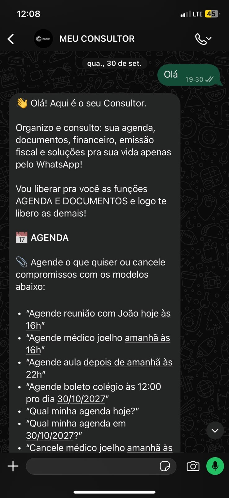
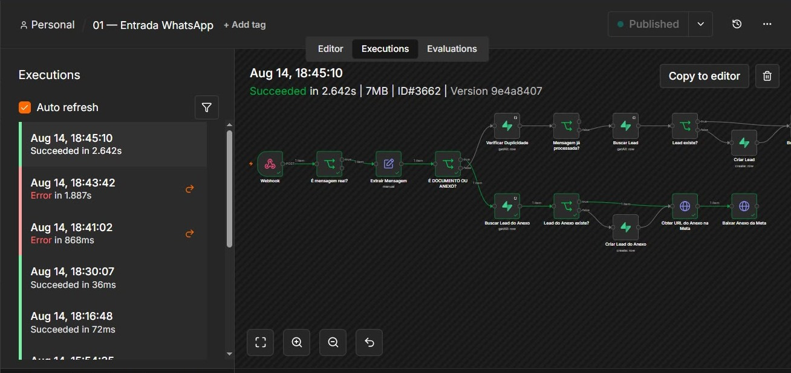
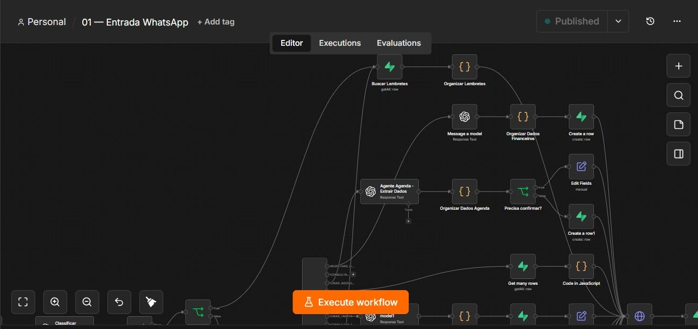

# MEU CONSULTOR AI

### Inteligência Artificial, Automação de Processos e Arquitetura SaaS

**Projeto autoral | Portfólio técnico | WhatsApp + n8n + Supabase + IA**

## Sobre o projeto

O MEU CONSULTOR AI é um projeto de software como serviço (SaaS) em desenvolvimento, concebido para centralizar atividades e automatizar processos por meio de uma interface conversacional no WhatsApp.

O projeto reúne conceitos de inteligência artificial, integração de APIs, automação de workflows, persistência de dados e arquitetura de sistemas.

Este repositório apresenta evidências visuais, decisões técnicas e funcionalidades demonstradas, sem divulgar integralmente o código-fonte ou a infraestrutura de produção.

## Tecnologias utilizadas

- **n8n:** criação, integração e orquestração de workflows.
- **Supabase:** persistência e gerenciamento de dados.
- **Inteligência Artificial:** interpretação de solicitações e extração de informações estruturadas.
- **WhatsApp:** interface conversacional com o usuário.
- **APIs e Webhooks:** comunicação entre serviços.
- **JavaScript:** tratamento e transformação de dados em automações.
- **GitHub:** documentação técnica e versionamento.

## Funcionalidades e evidências

### 1. Atendimento automatizado pelo WhatsApp

Interface conversacional para receber solicitações e apresentar as funcionalidades do assistente.

### 2. Agendamentos inteligentes

Fluxo demonstrado de solicitação, confirmação e consulta de compromissos diretamente pelo WhatsApp.

### 3. Execuções de workflows no n8n

Registros de execuções bem-sucedidas que evidenciam a operação de diferentes caminhos de automação.

### 4. Integração de documentos e anexos

Fluxo de recebimento, identificação e processamento de mensagens e anexos por meio de webhooks e integrações.

### 5. Agentes de IA para agenda

Uso de modelos de inteligência artificial para extrair dados, organizar solicitações e encaminhar ações de agendamento.

### 6. Gestão de tarefas e lembretes

Workflows para criação, consulta, atualização e cancelamento de tarefas e lembretes.

### 7. Roteamento de solicitações

Organização de fluxos com decisões condicionais e direcionamento de solicitações para operações específicas.

## Competências técnicas demonstradas

- Arquitetura e integração de soluções com inteligência artificial.
- Desenvolvimento de automações com n8n.
- Integração entre sistemas utilizando APIs e webhooks.
- Modelagem de fluxos e regras de negócio.
- Processamento e transformação de dados.
- Integração com banco de dados.
- Desenvolvimento de interfaces conversacionais.
- Diagnóstico e acompanhamento de execuções.
- Documentação de soluções técnicas.
- Construção e evolução de produtos digitais.

## Evolução do projeto

O MEU CONSULTOR AI está em desenvolvimento contínuo, com foco na ampliação das funcionalidades, confiabilidade das integrações, segurança dos dados e evolução da arquitetura SaaS.

As funcionalidades documentadas representam evidências de implementação e testes, não uma declaração de que todos os módulos estão disponíveis comercialmente.

## Objetivo deste portfólio

Demonstrar experiência prática na concepção, integração e evolução de soluções digitais envolvendo inteligência artificial, automação de processos, APIs e arquitetura SaaS.

**Observação:** este é um repositório de documentação e evidências técnicas. Credenciais, informações confidenciais e componentes privados da infraestrutura não são disponibilizados publicamente.
